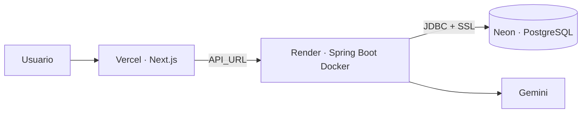

# Arquitectura · Pokedex+

## Visión general
```
Frontend (por definir, U3)  ──HTTP/JSON──▶  API REST Spring Boot  ──JPA──▶  PostgreSQL
                                                   │
                                                   └──HTTP (solo al importar)──▶  PokeAPI
```
El frontend solo habla con nuestra API. La PokeAPI se consulta únicamente durante la importación (F3); después, todo se sirve desde PostgreSQL.

## Backend (este repositorio)
- Java 21 · Spring Boot 4.1.2 · Spring Data JPA (Hibernate 7) · Maven (wrapper) · Lombok
- PostgreSQL (base de datos `pokedex_db`)
- `RestTemplate` con timeouts (5 s conexión, 15 s lectura) para la PokeAPI

### Capas (paquete `com.pokedex`)
| Paquete | Responsabilidad |
|---|---|
| `controller/` | Endpoints REST. Validan la entrada y lanzan excepciones propias |
| `service/` | `PokemonService`: toda la importación desde la PokeAPI. `EvolucionService`: arma el árbol de la cadena evolutiva desde la BD |
| `repository/` | Acceso a datos con Spring Data JPA |
| `entity/` | Entidades JPA |
| `exception/` | `GlobalExceptionHandler` y excepciones propias (400, 404, 409) |
| `config/` | CORS |

## Datos
Entidades: **Pokemon**, **Tipo**, **Ruta**, **Movimiento**, **Evolucion**

```
Pokemon N──N Tipo         (pokemon_tipo)
Pokemon N──N Ruta         (pokemon_ruta)        lugares donde aparece en estado salvaje
Pokemon N──N Movimiento   (pokemon_movimiento)  movimientos que puede aprender
```

- **Evolucion** (tabla `evolucion`): una fila por etapa de cada cadena evolutiva (`idPokedex`, `idCadena`, `idPreEvolucion`, `condicion`). No tiene clave foránea a `Pokemon`: una cadena puede incluir Pokémon no importados.
- `Pokemon.idPokedex` es la clave primaria: el número oficial de la Pokédex Nacional (1–1025).
- `Ruta.idPokeapi` identifica los lugares importados; es `null` en las rutas creadas a mano.
- El esquema lo mantiene Hibernate (`ddl-auto=update`): agrega columnas y tablas, pero no borra ni renombra.

## Contrato
`docs/contratos/api.md` es la fuente de verdad de endpoints, formatos y errores.

## Configuración
- Credenciales en `application-local.properties` (fuera de git) o en variables de entorno: `DB_URL`, `DB_USERNAME` y `DB_PASSWORD` en local; `SPRING_DATASOURCE_URL`, `SPRING_DATASOURCE_USERNAME` y `SPRING_DATASOURCE_PASSWORD` en la nube. La lista completa, solo con nombres, está en `docs/despliegue.md`.
- Pool de Hikari pequeño (`DB_POOL_MAX`=5, `DB_POOL_MIN`=0) para el plan gratuito de Neon.
- Carga por lotes de relaciones (`default_batch_fetch_size=50`) y `open-in-view=true`.

## Frontend (U3)
Next.js 16 + TypeScript + Tailwind, en el repositorio `pokedex-frontend`. Consume `http://localhost:8080/api` en desarrollo y la API de Render en producción (variable `API_URL`).

## Arquitectura desplegada (U6)
Frontend en Vercel, backend en Render (imagen Docker del `Dockerfile`) y PostgreSQL en Neon, todo en US East; con dos entornos (Neon `production` y `dev`). El diagrama (Mermaid), las equivalencias en AWS, el paso a paso, las variables, el rollback y la verificación están en [`despliegue.md`](despliegue.md). El CI (GitHub Actions) corre `mvnw verify` y construye la imagen Docker en cada push.


