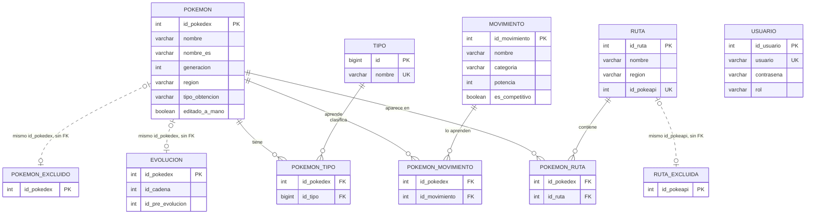

# Modelo de datos · Pokedex+

Fuente: las entidades de `src/main/java/com/pokedex/entity/`, los controllers y servicios que las escriben, y `schema.sql`. El esquema lo crea Hibernate (`ddl-auto=update`); `schema.sql` solo crea la extensión `unaccent` (F9). Los tipos de columna son los que Hibernate 7 genera para PostgreSQL a partir de las anotaciones. Las 11 tablas se comprobaron contra la base local con `\d` el 21 de noviembre de 2026 (ver "Por verificar").

F20 (identificar por foto) **no agrega tablas**: la foto no se guarda. Solo lee `pokemon` y `tipo`.

## Diagrama



El diagrama solo muestra las columnas que definen claves o reglas; la lista completa está en las tablas de abajo. Las líneas punteadas son vínculos **lógicos** (mismo número), no claves foráneas.

## Entidades

En "Nulo": **no** = `NOT NULL` en la BD; **sí** = acepta `null` en la BD. La columna "Regla" dice qué exige además el servidor.

### `pokemon` (entidad `Pokemon`)

| Campo | Tipo | Nulo | Regla |
|---|---|---|---|
| `id_pokedex` | integer, PK | no | Número oficial; **no** es autoincremental. Al crear: entero > 0 y libre (si no, 409) |
| `nombre` | varchar(100) | no | Slug en inglés. Al crear: `^[a-z0-9]+(-[a-z0-9]+)*$`. No cambia en PUT |
| `nombre_es` | varchar(100) | sí | Obligatorio en POST/PUT (servidor). `null` solo en importados antes de F6 |
| `descripcion` | text | sí | Opcional |
| `generacion` | integer | sí | Al crear: 1–9, obligatoria. De ella sale `region` |
| `region` | varchar(50) | sí | La calcula el servidor desde la generación; no llega en el cuerpo |
| `tipo_obtencion` | varchar(30) | sí | Uno de los 9 valores de `FormasObtencion` (servidor); la BD no lo restringe |
| `forma_obtencion` | text | sí | Opcional |
| `imagen_url` | varchar(500) | sí | Opcional; si viene, debe empezar por `https://` |
| `altura` | double precision | sí | Metros; ≥ 0 |
| `peso` | double precision | sí | Kilogramos; ≥ 0 |
| `ps`, `ataque`, `defensa`, `ataque_especial`, `defensa_especial`, `velocidad` | integer | sí | En POST/PUT: obligatorias, enteros de 1 a 255 |
| `editado_a_mano` | boolean | sí | Lo pone el servidor en `true` al crear o editar desde el panel; nunca viene del cuerpo. `null` en los importados sin tocar |
| *(`totalEstadisticas`)* | — | — | No es columna: `getTotalEstadisticas()` suma las 6 y da `null` si falta alguna |

### `tipo` (entidad `Tipo`)

| Campo | Tipo | Nulo | Regla |
|---|---|---|---|
| `id` | bigint, PK, identity | no | |
| `nombre` | varchar(50), UNIQUE | no | Nombre en inglés de la PokeAPI (`fire`). Solo lo crea la importación |

### `ruta` (entidad `Ruta`)

| Campo | Tipo | Nulo | Regla |
|---|---|---|---|
| `id_ruta` | integer, PK, identity | no | El servidor ignora cualquier `idRuta` del cuerpo |
| `nombre` | varchar(100) | no | Obligatorio y no vacío (servidor) |
| `region` | varchar(50) | sí | En POST/PUT es obligatoria (servidor); la BD acepta `null` |
| `descripcion` | text | sí | Opcional |
| `id_pokeapi` | integer, UNIQUE | sí | Solo el importador lo asigna; `POST /rutas` lo fuerza a `null`; `PUT` no lo toca |

### `movimiento` (entidad `Movimiento`)

| Campo | Tipo | Nulo | Regla |
|---|---|---|---|
| `id_movimiento` | integer, PK, identity | no | El servidor ignora cualquier id del cuerpo |
| `nombre` | varchar(100) | no | Obligatorio; en POST no puede repetirse (sin distinguir mayúsculas) |
| `nombre_es` | varchar(100) | sí | Opcional; vacío se guarda como `null` |
| `tipo` | varchar(20) | sí | Si viene, uno de los 18 tipos en inglés; se guarda en minúsculas |
| `categoria` | varchar(50) | no | `Físico`, `Especial` o `Estado` (se normaliza al valor canónico) |
| `potencia` | integer | sí | ≥ 0; si no viene se guarda 0 |
| `es_competitivo` | boolean | sí | Lo calcula el servidor: `potencia > 80`. No se acepta del cuerpo |

### `evolucion` (entidad `Evolucion`)

| Campo | Tipo | Nulo | Regla |
|---|---|---|---|
| `id_pokedex` | integer, PK | no | Número de la etapa. **Sin FK** a `pokemon`: la cadena puede incluir Pokémon no importados |
| `nombre` | varchar(100) | no | Slug de la especie |
| `id_cadena` | integer | no | Id de la cadena en la PokeAPI; lo comparten todas sus etapas |
| `id_pre_evolucion` | integer | sí | `null` en la etapa base. Sin FK |
| `condicion` | text | sí | En español; `null` en la etapa base |

### `usuario` (entidad `Usuario`)

| Campo | Tipo | Nulo | Regla |
|---|---|---|---|
| `id_usuario` | integer, PK, identity | no | |
| `usuario` | varchar(50), UNIQUE | no | |
| `contrasena` | varchar(100) | no | Hash BCrypt; nunca en claro; `@JsonIgnore` |
| `rol` | varchar(20) | no | Hoy solo `ADMIN` (`Usuario.ROL_ADMIN`). Ningún endpoint lo recibe |

### `pokemon_excluido` (entidad `PokemonExcluido`)

| Campo | Tipo | Nulo | Regla |
|---|---|---|---|
| `id_pokedex` | integer, PK | no | Pokémon borrado a mano. La importación lo salta. Crearlo con POST borra su fila |

### `ruta_excluida` (entidad `RutaExcluida`)

| Campo | Tipo | Nulo | Regla |
|---|---|---|---|
| `id_pokeapi` | integer, PK | no | Lugar importado que se borró a mano. La importación lo salta |

### Tablas intermedias (`@ManyToMany` de `Pokemon`)

| Tabla | Columnas | FK | Regla |
|---|---|---|---|
| `pokemon_tipo` | `id_pokedex` integer, `id_tipo` bigint (ambas NOT NULL) | → `pokemon`, → `tipo` | Un Pokémon tiene 1 o 2 tipos (servidor) |
| `pokemon_ruta` | `id_pokedex` integer, `id_ruta` integer (ambas NOT NULL) | → `pokemon`, → `ruta` | Las rutas enviadas deben existir (servidor y FK) |
| `pokemon_movimiento` | `id_pokedex` integer, `id_movimiento` integer (ambas NOT NULL) | → `pokemon`, → `movimiento` | Solo la llena la importación. Antes de borrar un movimiento se desvincula |

`Tipo.pokemons` y `Ruta.pokemons` son el lado inverso (`mappedBy`): no generan columnas.

## Restricciones reales

| Tipo | Dónde |
|---|---|
| **PK** | `pokemon.id_pokedex`, `tipo.id`, `ruta.id_ruta`, `movimiento.id_movimiento`, `evolucion.id_pokedex`, `usuario.id_usuario`, `pokemon_excluido.id_pokedex`, `ruta_excluida.id_pokeapi` |
| **FK** | Solo las 6 de las tablas intermedias (ver arriba). `evolucion`, `pokemon_excluido` y `ruta_excluida` **no** tienen |
| **UNIQUE** | `tipo.nombre`, `ruta.id_pokeapi`, `usuario.usuario` |
| **NOT NULL** | `pokemon.nombre`, `tipo.nombre`, `ruta.nombre`, `movimiento.nombre` y `categoria`, `evolucion.nombre` y `id_cadena`, `usuario.usuario`, `contrasena` y `rol` |
| **CHECK** | Ninguno |

## Reglas de negocio y la capa que las garantiza

"BD" = la restricción existe en PostgreSQL. "Servidor" = solo la comprueba el código; la BD aceptaría el dato.

| Regla | Capa | Dónde |
|---|---|---|
| El número de Pokédex no se repite | **Ambas** | `GestionPokemonService.crear` (409) y PK |
| El nombre de un tipo no se repite | **BD** | `UNIQUE` en `tipo.nombre` |
| `idPokeapi` de una ruta no se repite | **BD** | `UNIQUE` en `ruta.id_pokeapi` |
| El usuario no se repite | **Ambas** | `UNIQUE` y `AdministradorInicial` (`existsByUsuario`) |
| Un movimiento no repite nombre (sin distinguir mayúsculas) | **Servidor** | `MovimientoController` (`existsByNombreIgnoreCase`); sin `UNIQUE` |
| Una ruta no repite nombre + región | **Servidor** | `RutaController` (`existsByNombreIgnoreCaseAndRegionIgnoreCase`); sin `UNIQUE` |
| Estadísticas enteras de 1 a 255; altura y peso ≥ 0; generación 1–9 | **Servidor** | `DatosPokemon` |
| `nombre` en formato slug; `imagenUrl` con `https://` | **Servidor** | `DatosPokemon` |
| `tipoObtencion` es uno de los 9 valores | **Servidor** | `DatosPokemon` / `FormasObtencion` |
| 1 o 2 tipos, y que existan | **Servidor** (+ FK al guardar) | `DatosPokemon`, `GestionPokemonService.resolverRelaciones` |
| Las rutas enviadas existen | **Ambas** | `resolverRelaciones` (400 con `campos`) y FK de `pokemon_ruta` |
| `region` sale de la generación | **Servidor** | `PokemonService.regionDeGeneracion` |
| `totalEstadisticas` se calcula, no se guarda | **Servidor** | `Pokemon.getTotalEstadisticas()` |
| `categoria` ∈ {Físico, Especial, Estado}; `tipo` ∈ los 18; `potencia` ≥ 0 | **Servidor** | `MovimientoController.validar` |
| `esCompetitivo` = `potencia > 80` | **Servidor** | `MovimientoController.prepararCampos` |
| Una ruta creada a mano no lleva `idPokeapi` | **Servidor** | `RutaController.guardarRuta` |
| Borrar un Pokémon lo anota en `pokemon_excluido`; crearlo lo quita | **Servidor** (transacción) | `GestionPokemonService` |
| Borrar una ruta importada la anota en `ruta_excluida` | **Servidor** (transacción) | `RutaController.eliminarRuta` |
| Borrar un movimiento o ruta primero se desvincula de los Pokémon | **Ambas** | `desvincularDePokemons`; la FK rechazaría el borrado si no |
| La reimportación salta lo excluido y no pisa lo `editado_a_mano` | **Servidor** | `PokemonService` |
| La contraseña se guarda con BCrypt | **Servidor** | `AdministradorInicial` (`cifrador.encode`) |
| Solo ADMIN escribe; el rol sale del JWT | **Servidor** | `SeguridadConfig` (claim `rol`) |
| `editadoAMano` lo decide el servidor, no el cuerpo | **Servidor** | `GestionPokemonService.aplicar` |

## Quién escribe cada tabla

"Importación" = `POST/GET /pokemons/importar-rango` e `importar-todo`, que exigen ADMIN. "Arranque" = proceso interno, sin endpoint. Todos los `GET` son públicos y solo leen.

| Tabla | Público (sin token) | ADMIN (JWT) | Proceso interno |
|---|---|---|---|
| `pokemon` | Solo lectura | `POST`, `PUT`, `DELETE /pokemons`; importación | — |
| `pokemon_tipo` | Solo lectura | Con `POST`/`PUT /pokemons`; importación | — |
| `pokemon_ruta` | Solo lectura | Con `POST`/`PUT`/`DELETE` de Pokémon; `DELETE /rutas/{id}` la vacía de esa ruta; importación | — |
| `pokemon_movimiento` | Solo lectura | `DELETE /movimientos/{id}` la vacía de ese movimiento; importación | — |
| `tipo` | Solo lectura | Solo por importación (no hay `POST /tipos`) | — |
| `ruta` | Solo lectura | `POST`, `PUT`, `DELETE /rutas`; importación | — |
| `movimiento` | Solo lectura | `POST`, `PUT`, `DELETE /movimientos`; importación (solo `nombre_es` y `tipo` si era `null`) | — |
| `evolucion` | Solo lectura | Solo por importación | — |
| `pokemon_excluido` | Nadie | Indirectamente: `DELETE`/`POST /pokemons` | — |
| `ruta_excluida` | Nadie | Indirectamente: `DELETE /rutas/{id}` | — |
| `usuario` | Nadie. `POST /auth/login` solo la lee | Nadie: no hay endpoint | `AdministradorInicial` la crea al arrancar desde `ADMIN_USERNAME` y `ADMIN_PASSWORD` |

Las únicas escrituras públicas de la API serán `POST /auth/login` (no escribe nada) y `POST /pokemons/identificar` (F20: tampoco escribe nada). Ninguna tabla se puede modificar sin token.

## Por verificar

Revisado por Julián Camilo Aya Mendoza el 21 de noviembre de 2026, contra la base local (PostgreSQL 18, base `pokedex`).

**Confirmado con `\d`:**
- `pokemon_tipo`, `pokemon_ruta` y `pokemon_movimiento` tienen las dos columnas `NOT NULL`, sus 2 FK cada una y **ningún otro índice ni restricción**: no hay PK ni `UNIQUE`.
- **Duplicados en esas tres tablas: 0 hoy** (las consultas de abajo devolvieron 0 filas en las tres). Pero la BD no los impide, porque no hay PK ni `UNIQUE`: solo lo evita el código.
- Las otras 8 tablas coinciden con las entidades, columna por columna (tipos, largos y `NOT NULL`):
  - `pokemon`: PK `id_pokedex` sin identity; solo `id_pokedex` y `nombre` son `NOT NULL`. Las estadísticas, altura, peso y `tipo_obtencion` aceptan `null` en la BD.
  - `tipo`: PK `id` bigint identity y `UNIQUE` en `nombre`.
  - `ruta`: PK identity y `UNIQUE` en `id_pokeapi`; sin `UNIQUE` en `nombre + region`.
  - `movimiento`: PK identity; sin `UNIQUE` en `nombre`.
  - `evolucion`: PK `id_pokedex` y ninguna FK, ni de ida ni de vuelta.
  - `usuario`: PK identity y `UNIQUE` en `usuario`.
  - `pokemon_excluido` y `ruta_excluida`: solo su PK, sin FK.
- No hay ninguna restricción `CHECK` en ninguna tabla (confirma la fila "CHECK: ninguno" de "Restricciones reales").
- Nada de lo que muestra la salida contradice este documento.

**Consultas de duplicados** (para repetirlas, por ejemplo tras una reimportación; cero filas = sin duplicados):
```sql
SELECT id_pokedex, id_tipo, COUNT(*) FROM pokemon_tipo GROUP BY 1, 2 HAVING COUNT(*) > 1;
SELECT id_pokedex, id_ruta, COUNT(*) FROM pokemon_ruta GROUP BY 1, 2 HAVING COUNT(*) > 1;
SELECT id_pokedex, id_movimiento, COUNT(*) FROM pokemon_movimiento GROUP BY 1, 2 HAVING COUNT(*) > 1;
```

**Sin comprobar todavía:** nada. Las 11 tablas y los duplicados están comprobados contra la base local.

**Brechas conocidas** (no son errores del documento):
- Unicidad solo en el servidor (`movimiento.nombre`, `ruta.nombre + region`) y pares repetidos en las tablas intermedias que la BD no impide: dos peticiones simultáneas podrían crear duplicados. Riesgo bajo, porque solo escribe el ADMIN.
- Los nombres de las FK los genera Hibernate (`fke0e274c…`, etc.) y cambian si se recrea el esquema.

**Cambios de esquema:** se mantiene `ddl-auto=update`, también en producción, con `pg_dump` antes de cada despliegue que cambie entidades. Flyway queda como deuda técnica. Ver la decisión del 2026-11-21 en `docs/decisiones.md` ("Se mantiene `ddl-auto=update` también en producción…").
